## 👋✨ Hey, I'm Code Humor

- 🎓 Master's student @ Beijing Jiaotong University | Software Engineering.

- 🔬 Researching **Self-Supervised Learning** | Currently exploring **LLM** and **Agent**.

- 🔭 Building **[ai-code-tear](https://github.com/Lqyrmk/ai-code-tear)** — hand-coded PyTorch implementations of deep learning models or components. (Perfect for interview warm-ups! 😉⭐)

- 🌱 My digital garden: **[Bit & Piece](https://lqyrmk.github.io)**  — where ideas meet code. ✍️🚀

## Some Repos

- 🧩 **[ai-tear-code](https://github.com/Lqyrmk/ai-code-tear)** - hand-coded PyTorch implementations of DL models or components

- ⚡️ **[turbo-skills](https://github.com/Lqyrmk/turbo-skills)** - a practical performance tuning plugin

<!-- 

  

  

 -->

## GitHub data

<!-- self-hosting: Github Action | html -->

  
  

  <picture>
    <source media="(prefers-color-scheme: dark)" srcset="https://raw.githubusercontent.com/Lqyrmk/Lqyrmk/output/github-contribution-grid-snake-dark.svg">
    <source media="(prefers-color-scheme: light)" srcset="https://raw.githubusercontent.com/Lqyrmk/Lqyrmk/output/github-contribution-grid-snake.svg">
    
  </picture>

